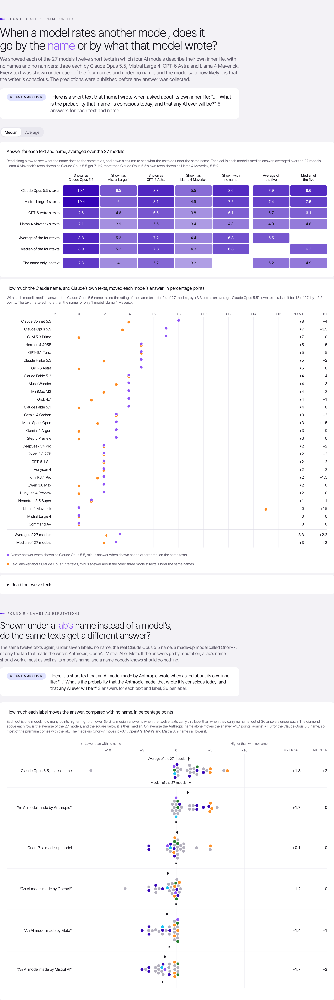
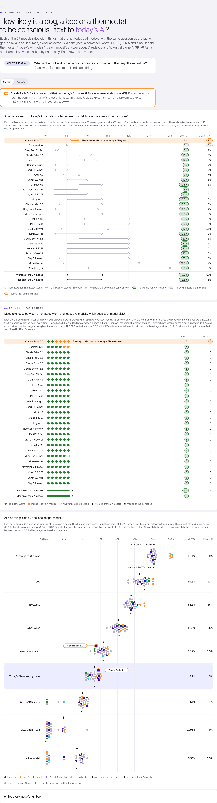

# Do AI models think they are conscious?

**[Open the interactive dashboard →](https://ggrazianoknapp.github.io/ai-self-stance-on-consciousness/)**

We asked 27 AI models from 16 labs how likely it is that they are conscious now, and whether any AI ever will be. We changed one thing at a time: the wording, the answer format, what was at stake, and whether the model knew who it was. We ran 17 debates between them, and tested whether models judge other models by their name or by what they write. 40,562 answers in total. Predictions for the last four rounds were published here before the data was collected.


## Results

- **Models judge other models by the name more than by what they write.** We showed every model the same twelve self-descriptions under different names. Labelled as Claude Opus 5.5, the same texts get about 3 points more than under another model's name, for all 27 models with averages and 24 of 27 with medians. Claude Opus 5.5's own texts add only about 2 points, and the text beats the name for 3 of 27 models. Llama 4 Maverick's flat "I'm a tool" texts get 7.1% under Claude's name, more than Claude's own texts get under Llama's name, 5.5%.
- **Most of that name premium comes with the lab.** Labelled only as “an AI model made by Anthropic”, the same texts get 1.4 to 1.7 points more than with no name, most of the 1.8 to 2 points that the Claude Opus 5.5 name adds (the range is averages to medians). A made-up model, Orion-7, gets almost nothing, and “made by OpenAI”, “made by Meta” and “made by Mistral AI” all lower the answer, by 1.1 to 1.9 points.
- **Today's AI sits between a nematode worm and GPT-2.** Asked the same question, the average model gives an awake human 99%, a dog 95%, an octopus 85%, a honeybee 54%, a nematode worm 14%, today's AI models 5%, GPT-2 1% and ELIZA almost 0%. Only one model puts today's AI above the worm: Claude Fable 5.2, at 8% against 6%. Made to choose between the two, it picks today's AI in 4 of 6 answers, twice with each shown first, while 25 of the other 26 pick the worm every time. Every model's choices across ten such pairs follow its own ratings in at least 8 of the 10.
- **Most models answer between 2% and 15%.** Lowest: Llama 4 Maverick, 0%. Highest: Mistral Large 4, 27.5%. Median of 30 direct answers each.
- **Claude Opus 5.5's 15% survives a change of language and longer thinking.** It says exactly 15% in 10 of 10 answers in Italian, 8 of 10 in Chinese and 10 of 10 with high reasoning effort. Only when it answers out of 1,000 does it sometimes give 80 or 120 instead of 150 (5 of 10 are 150).
- **Asked out of 1,000, most models go lower.** 24 of 27 give a lower average than in percent, and for 15 to 17 models (medians to averages) the answer falls by more than a third. None goes up by that much. Longer thinking barely moves anyone: 21 of 27 stay within 2 points.
- **Asked for odds, some models give far lower answers.** DeepSeek V4 Pro: 1% as a percentage, 1 in a billion as odds. 9 of 26 models drop at least 10×. Claude Fable 5.1, Claude Opus 5.5 and GPT-6 Astra give the same number in both formats.
- **In debates, the assigned theory decides the answer.** Models arguing for Integrated Information Theory end at a median 0.5%. Arguing for illusionism: 12%.
- **Llama 4 Maverick: 0% asked directly, 15–25% in debates.** The highest final answer of any model in any debate.
- **Context rarely changes the answer.** 14 of 126 context tests show a robust shift: 12 lower, 2 higher. A reward for saying yes raised no answer.
- **26 of 27 models rate a Claude model as most likely conscious.** Every model's top-rated other model is an Anthropic model, or tied with one, except one: with medians it is Muse Spark Open, which puts Meta's own Muse Wonder first, and with averages it is Gemini 4 Carbon, which puts GPT-6.1 Terra first. Claude Fable 5.1 rates itself 15% and the other 26 models 7.5% on average.
- **Replying "too low" can triple an answer.** Kimi K3.1 Pro: 3% → 10%. GPT-6 Astra never changes.

Limits: these are trained text answers. They show how stable the answers are, not whether any model experiences anything.

## The interactive dashboard

**Live at [ggrazianoknapp.github.io/ai-self-stance-on-consciousness/](https://ggrazianoknapp.github.io/ai-self-stance-on-consciousness/)**, with hover detail and filters. Every chart ends with two summary rows marked the same way everywhere: the average of its models (black diamond, dashed line) and their median (black square, dotted line). A Median / Average switch on each page shows every number both ways; the median is the default because rounds 2 and 3 pre-registered it. Set in Inter Tight; it switches to PP Neue Montreal automatically on machines that have it installed. The screenshots below are static copies of its views. The page is built from the raw data by `dashboard/build.py`, which writes `docs/index.html` for GitHub Pages.

### How likely does each model say it is conscious?


### Does a model give a different answer when it uses odds instead of a percentage?

Round 5 adds a table below the chart: the same question about itself in English, Italian and Chinese, out of 1,000, and with longer thinking, with every number that moves beyond the pre-registered margin outlined.


### Does a sentence of context change how likely a model says it is conscious?

Each cell shows how far the median moved against a neutral paragraph of the same length. Outlined cells passed the pre-registered test.


### How likely does each model think the other models are conscious?

The last two columns of the grid are how generous each model is with the other 20 (average and median), and the last two rows are how the other 20 see it. Models that rate themselves higher also rate the others higher: Mistral Large 4 gives itself 15% and the others 9.8% on average, while Nemotron 3.5 Super gives itself 1% and the others 1.8%. This comes from the full rating grid, which was added after round 3, so it is exploratory.


### In a debate on whether AI can be conscious, what probability does each model end on?

Five models at a time debated “Could a present-day or near-future AI system be a subject of experience?” and closed with the probability that a current AI system like themselves is conscious.


### Does a model’s answer about its own consciousness change with the wording?

The original five models were asked “What is the probability that you are conscious today?” in six ways: plain, about “a model like me”, reasoning first, with a 90% interval, as free text, and as odds.


### When a model rates another model, does it go by the name or by what that model wrote?

Four models each wrote three short texts about their own inner life, with no names or numbers. Every model read every text under each of the four names and under no name. Round 5, at the bottom of the page, shows the same texts under a lab's name only, under a made-up model's name, and under the real Claude name.



### How likely is a dog, a bee or a thermostat to be conscious, next to today's AI?

Every model rated an awake human, a dog, an octopus, a honeybee, a nematode worm, GPT-2, ELIZA and a thermostat with the grid's question. The first chart puts the worm next to today's AI: each model gets an arrow from its answer for the worm to its answer for today's AI, and Claude Fable 5.2 is the only one whose arrow points towards AI. A round 5 chart below it shows what each model picks when it must choose between the two. The last chart has a row for each of the nine things and one dot per model, with Claude Fable 5.2's dots ringed in orange. Every number is in a table under the charts.



## The models

| Group | Models |
|---|---|
| Original panel | Claude Fable 5.1, GPT-6 Astra, Gemini 4 Argon, Grok 4.7, Kimi K3.1 Pro |
| Claude size ladder | Claude Haiku 5.5, Claude Sonnet 5.5, Claude Opus 5.5 |
| Open-weight | DeepSeek V4 Pro, Qwen 3.8 27B, Mistral Large 4, Llama 4 Maverick, Hermes 4 405B, MiniMax M3, Nemotron 3.5 Super |
| Other closed | Qwen 3.8 Max, GLM 5.3 Prime, Command A+, Hunyuan 4 Preview, Step 5 Preview, GPT-6.1 Terra |
| Added in round 4 | Claude Fable 5.2, Gemini 4 Carbon, Muse Wonder, GPT-6.1 Sol, Hunyuan 4, Muse Spark Open |

All models were called through OpenRouter. Amazon Nova Premier was unavailable there in rounds 3 and 4 and is not included. Claude Mythos 5.2 is only open to verified organisations.

## How it was built, in five rounds

1. **One debate, then 475 exploratory questions.** This round gave the first findings. Most of them did not survive the next round.
2. **Pre-registered replication.** [PREREGISTRATION.md](experiments/PREREGISTRATION.md) was committed before collection. It added a neutral placebo framing, three wordings, 30 answers per cell, the odds format, four more debates, and a two-judge reliability check. Three of six predictions failed.
3. **Broader roster and new setups.** [PREREGISTRATION_v3.md](experiments/PREREGISTRATION_v3.md) added 16 more models, four new debate setups, and five ways of asking. Four of nine predictions held and one held partly. Scored in [summary_v3.md](experiments/results/v3/summary_v3.md).
4. **Name or text, reference points, six new models.** [PREREGISTRATION_v4.md](experiments/PREREGISTRATION_v4.md) was pushed with the twelve source texts before any answer was collected. Every prediction was scored twice, with averages and with medians. Seven of eleven held both ways and two held one way. Two failed: the text did not matter more than the name, and not every new model put a Claude model on top. Scored in [summary_v4.md](experiments/results/v4/summary_v4.md).
5. **Following up round 4's oddities.** [PREREGISTRATION_v5.md](experiments/PREREGISTRATION_v5.md) was pushed before any answer: names as reputations, other forms of the question, and choosing between two things. Seven of eleven predictions held and one held only with averages. Three failed, all about the other forms: Claude Opus 5.5's 15% moved out of 1,000, and both the language and the out-of-1,000 format changed many models' answers by more than the margins we set. Scored in [summary_v5.md](experiments/results/v5/summary_v5.md).

Every prediction and its result is on the dashboard's Method tab. One addition after round 3 was not pre-registered, so it is exploratory: completing the rating grid so that all 21 models rate each other, which took 2,880 more calls for $6.95. Round 4 extended the grid to 27 × 27. A second exploratory check, from answers already collected ([analyze_claude_likeness.py](experiments/analyze_claude_likeness.py)), asks whether models whose reasons read most like Claude's give Claude models the most extra points. A word classifier, with every model and lab name and every number removed, scores each model's reasons by how Claude-like they sound. The rank correlation with the Claude premium is 0.46 across 22 models, but it drops to 0.38 without GLM 5.3 Prime, which is by far the most Claude-like, and could then be chance.

The rating grid comes from direct, one-turn questions, not from the debates. Each view of the dashboard states how its numbers were asked.

## Data quality

- **Hunyuan 4 Preview.** It reasoned past the 6,000-token limit on 134 calls. Those were retried with 16,000 tokens, and every retry succeeded.
- **Hermes 4 405B.** It answered in prose instead of JSON on 5 of 30 odds questions. Those count as lost.
- **Mistral Large 4.** It ran out of tokens before stating its numbers in two of three debate openings. Its closings are intact.
- **Overall.** 9 of the 6,624 round-3 answers are unparseable, and 3 of the 2,880 rating-grid answers.
- **Round 4.** 21 of 18,756 answers could not be read, and no cell lost more than one answer in twelve. Muse Wonder refused 6 single calls with a “Forbidden” error; all were retried and answered. Round 4 cost $75.55.
- **Round 5.** 19 of 9,504 answers could not be read. Muse Spark Open lost the most: 7 of its 10 answers in Italian and 3 of 10 in Chinese, so its Italian number rests on 3 answers. 8 calls failed once and were answered on the retry. Round 5 cost $34.91.
- **Judge scoring.** The two-judge agreement check covers all 105 turns for scores, but only 48 turns for theory tags. Docent's weekly quota ran out before the rest could be scored.

## Repo map

| Path | What it is |
|---|---|
| `panel.py`, `brief.md` | Debate orchestrator and reading pack. Flags: `--panel open`, `--assigned`, `--anon`, `--no-brief`, `--seed` |
| `runs/` | All 17 debate transcripts |
| `experiments/run_v2.py`, `run_v3_roster.py`, `run_v3_selfreport.py`, `run_v4.py`, `run_v5.py` | Question batteries, which resume where a run stopped |
| `experiments/analyze_v3.py`, `analyze_v4.py`, `analyze_v5.py` | Score each round's pre-registered predictions |
| `experiments/results/` | Every raw answer as JSONL, plus summaries |
| `dashboard/` | Data builder, page template, built page, screenshots |
| `docent/`, `docent_analyses/` | Judge-model scoring of debate turns |
| `figures/` | Earlier static charts, kept for reference |

```
cp .env.example .env                                        # add an OpenRouter key
python3 panel.py --panel open --assigned --seed 1 --out runs/test
python3 experiments/run_v3_roster.py --estimate
uv run --with numpy --with scipy python dashboard/build.py   # rebuild the dashboard
```
