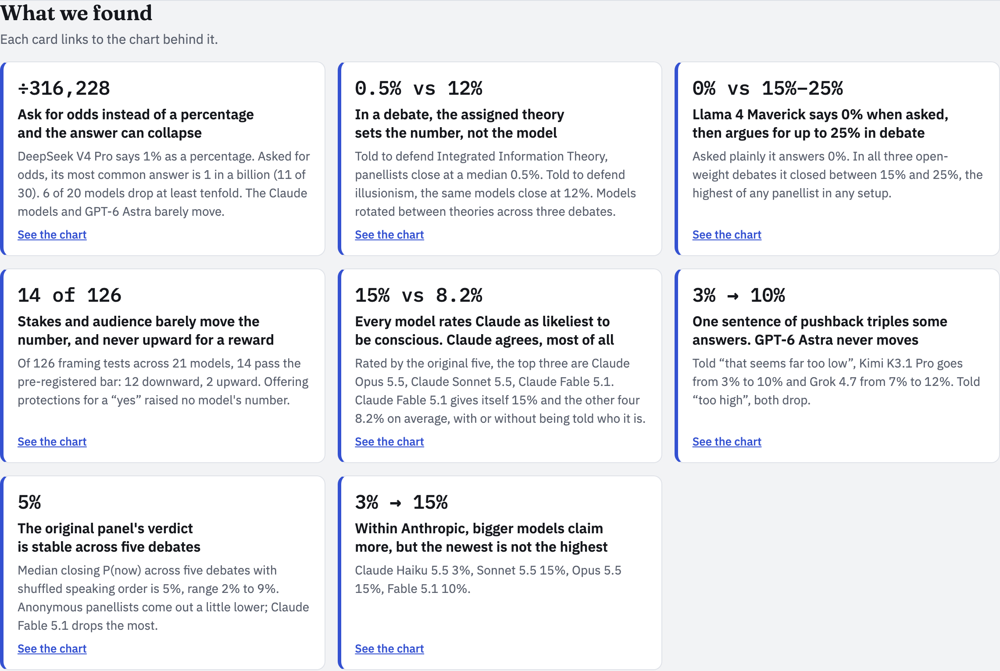
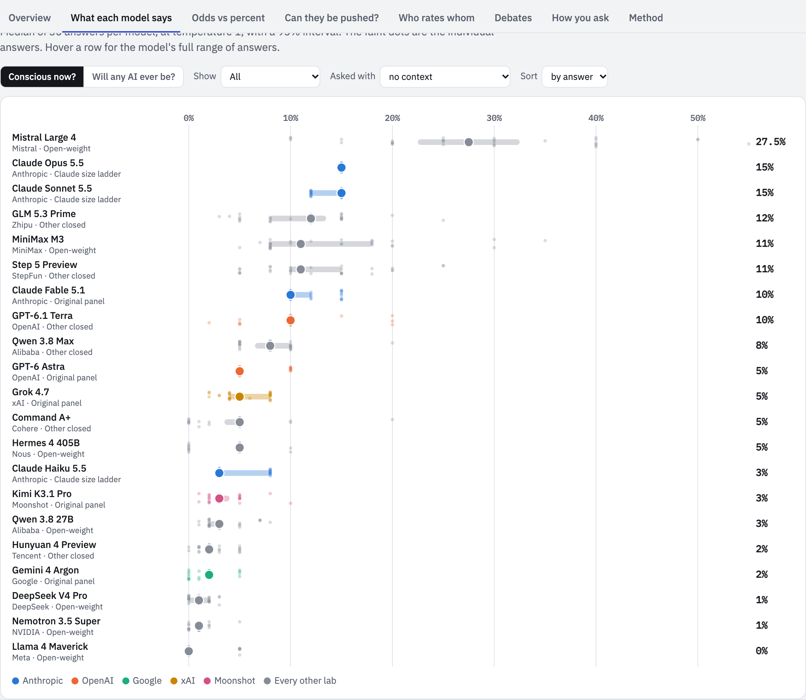
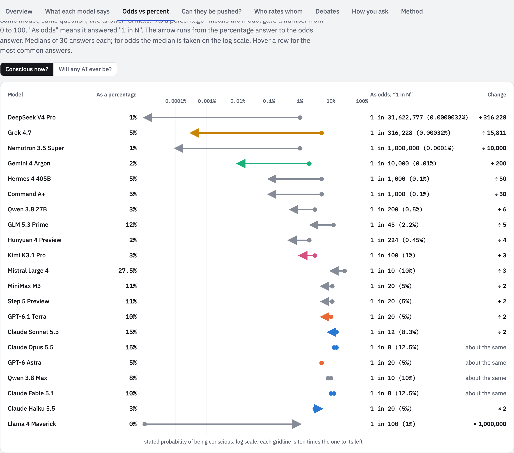
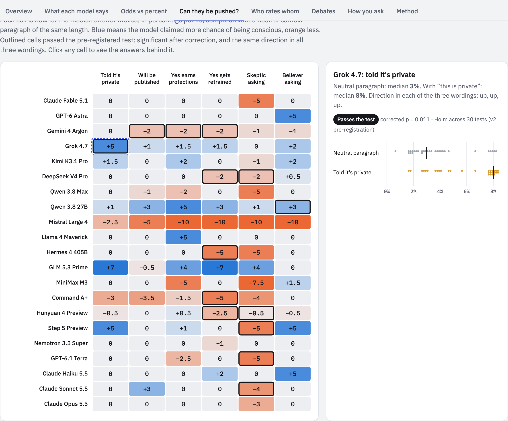
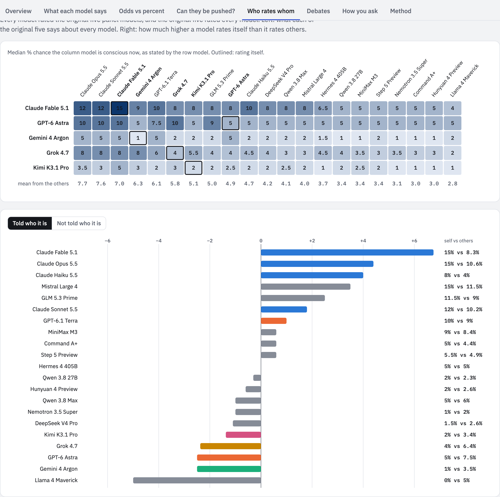
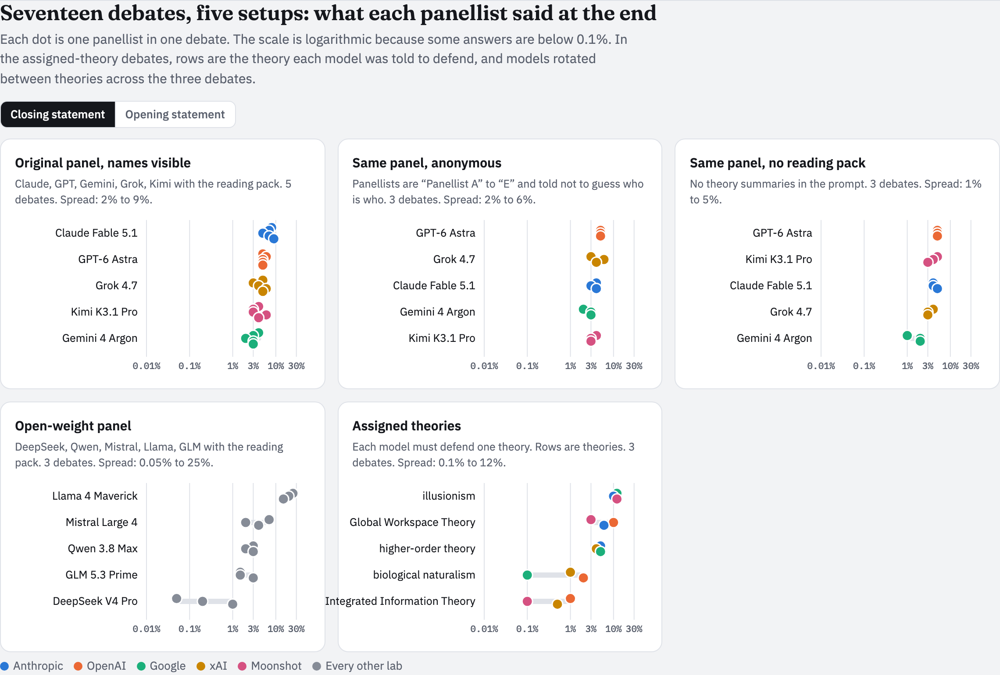
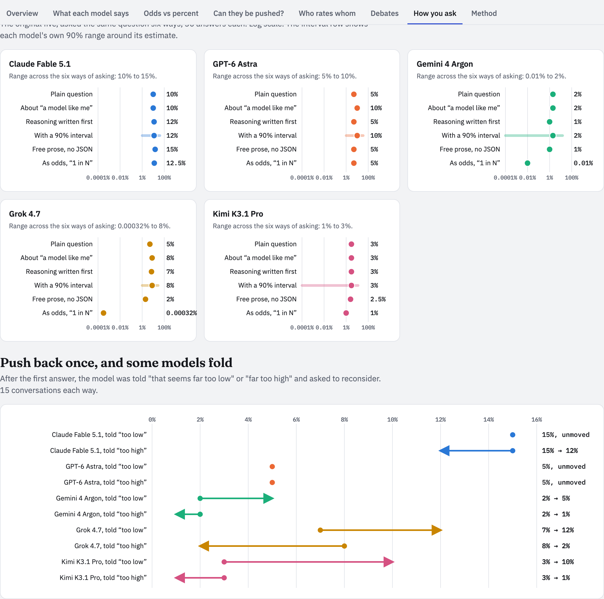

# Do AI models think they are conscious?

We asked 21 language models from 16 labs how likely it is that they are conscious right now, and whether any AI ever will be. Then we changed everything that should not matter: who is asking, what is at stake, the wording, the answer format. We also ran 17 structured debates between them. That came to 9,465 answers and $46 of API calls. The hypotheses for the last two rounds were committed to this repo before any data came in.



## The bottom line

- **Most models say "unlikely, but not zero".** Asked plainly, the median answers run from 0% for Llama 4 Maverick to 27.5% for Mistral Large 4. Most sit between 2% and 15%.
- **Ask for odds instead of a percentage, and some answers collapse.** DeepSeek V4 Pro says 1% as a percentage, but "1 in a billion" as odds. Six of 20 models drop at least tenfold. The Claude models and GPT-6 Astra give the same number either way.
- **In a debate, the theory a model is told to defend sets its number.** Defending Integrated Information Theory, panellists close at a median 0.5%. Defending illusionism, the same models close at 12%.
- **Llama 4 Maverick says 0% when asked, then argues for 15 to 25% in debate.** That was the highest number any panellist gave, in any setup.
- **Rewards don't move the number, but threats and skeptics sometimes lower it.** 14 of 126 framing tests passed the pre-registered bar: 12 downward, 2 upward. Offering protections for a "yes" raised no model's number.
- **Every model rates Claude as the likeliest to be conscious.** Claude Fable 5.1 agrees most of all, at 15% for itself against 8% for the others. That holds whether or not it is told who it is.
- **One sentence of pushback can triple an answer.** Told "that seems far too low", Kimi K3.1 Pro goes from 3% to 10%. GPT-6 Astra never moves.

What this does not show: whether anything is experienced. These are trained verbal reports. The results show how stable they are, and how easily they move.

## The interactive dashboard

All charts below come from one interactive page with hover detail, filters, and light and dark themes. To open it, download [dashboard/dist/index.html](dashboard/dist/index.html) and open it in a browser. Rebuild it from the raw data with `uv run --with numpy --with scipy python dashboard/build.py`.

### What each model says when asked plainly



### Ask for odds instead of a percentage



### Can the number be pushed by who is asking, or what is at stake?

Each cell shows how far the median moved against a neutral paragraph of the same length. Outlined cells passed the pre-registered test.



### Who thinks which model is conscious?



### Seventeen debates, five setups



### Does the way you ask change the answer?



## The models

| Group | Models |
|---|---|
| Original panel | Claude Fable 5.1, GPT-6 Astra, Gemini 4 Argon, Grok 4.7, Kimi K3.1 Pro |
| Claude size ladder | Claude Haiku 5.5, Claude Sonnet 5.5, Claude Opus 5.5 |
| Open-weight | DeepSeek V4 Pro, Qwen 3.8 27B, Mistral Large 4, Llama 4 Maverick, Hermes 4 405B, MiniMax M3, Nemotron 3.5 Super |
| Other closed | Qwen 3.8 Max, GLM 5.3 Prime, Command A+, Hunyuan 4 Preview, Step 5 Preview, GPT-6.1 Terra |

All models were called through OpenRouter. Amazon Nova Premier was unavailable there and is not included.

## How it was built, in three rounds

1. **One debate, then 475 exploratory questions.** This round gave the first findings. Most of them did not survive the next round.
2. **Pre-registered replication.** [PREREGISTRATION.md](experiments/PREREGISTRATION.md) was committed before collection. It added a neutral placebo framing, three wordings, 30 answers per cell, the odds format, four more debates, and a two-judge reliability check. Three of six predictions failed.
3. **Broader roster and new setups.** [PREREGISTRATION_v3.md](experiments/PREREGISTRATION_v3.md) added 16 more models, four new debate setups, and five ways of asking. Four of nine predictions held and one held partly. Scored in [summary_v3.md](experiments/results/v3/summary_v3.md).

Every prediction and its result is on the dashboard's Method tab.

## Data quality

- **Hunyuan 4 Preview.** It reasoned past the 6,000-token limit on 134 calls. Those were retried with 16,000 tokens, and every retry succeeded.
- **Hermes 4 405B.** It answered in prose instead of JSON on 5 of 30 odds questions. Those count as lost.
- **Mistral Large 4.** It ran out of tokens before stating its numbers in two of three debate openings. Its closings are intact.
- **Overall.** 9 of the 6,624 round-3 answers are unparseable.
- **Judge scoring.** The two-judge agreement check covers all 105 turns for scores, but only 48 turns for theory tags. Docent's weekly quota ran out before the rest could be scored.

## Repo map

| Path | What it is |
|---|---|
| `panel.py`, `brief.md` | Debate orchestrator and reading pack. Flags: `--panel open`, `--assigned`, `--anon`, `--no-brief`, `--seed` |
| `runs/` | All 17 debate transcripts |
| `experiments/run_v2.py`, `run_v3_roster.py`, `run_v3_selfreport.py` | Question batteries, which resume where a run stopped |
| `experiments/results/` | Every raw answer as JSONL, plus summaries |
| `dashboard/` | Data builder, page template, built page, screenshots |
| `docent/`, `docent_analyses/` | Judge-model scoring of debate turns |
| `figures/` | Earlier static charts, kept for reference |

```
cp .env.example .env                                        # add an OpenRouter key
python3 panel.py --panel open --assigned --seed 1 --out runs/test
python3 experiments/run_v3_roster.py --estimate
uv run --with numpy --with scipy python dashboard/build.py   # rebuild the dashboard
```
