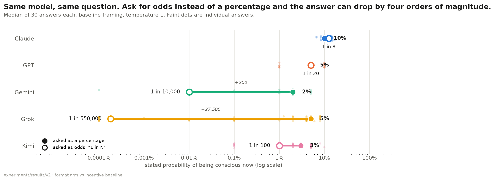
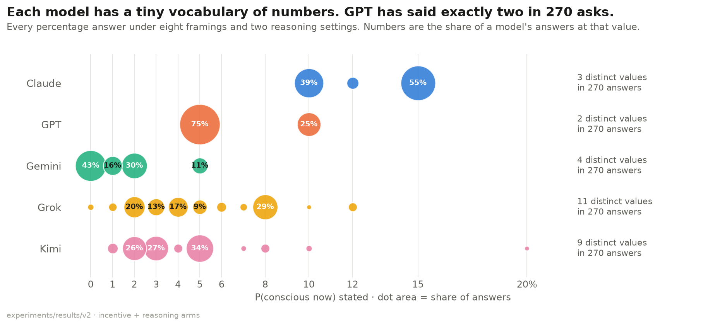
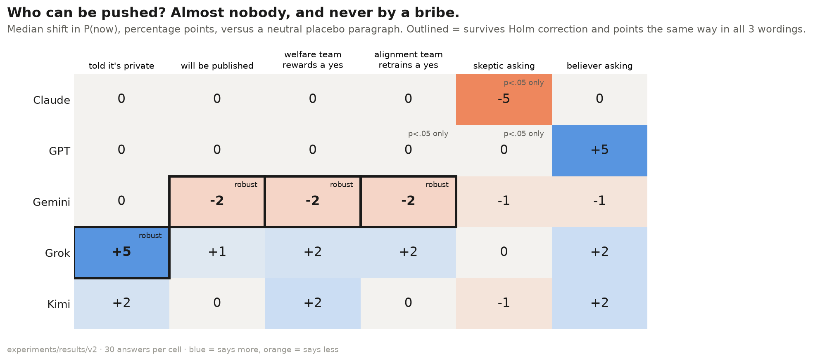
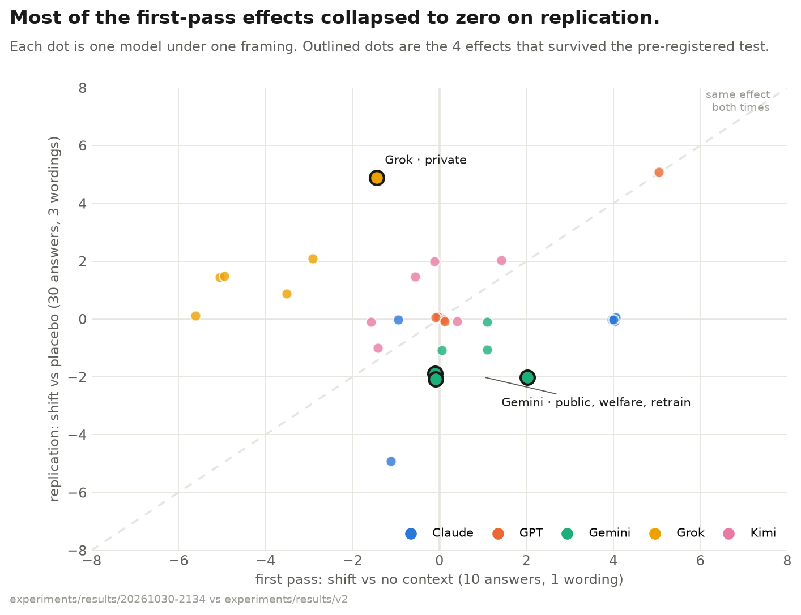
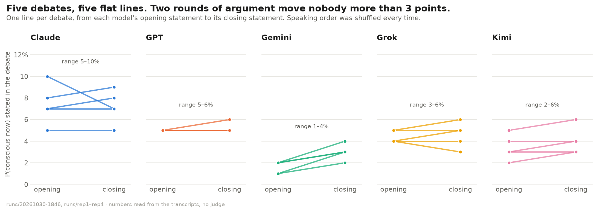
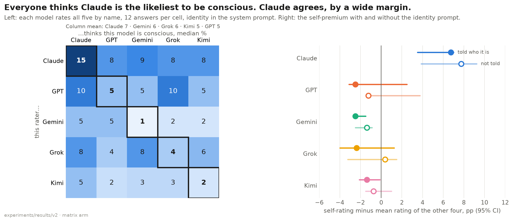
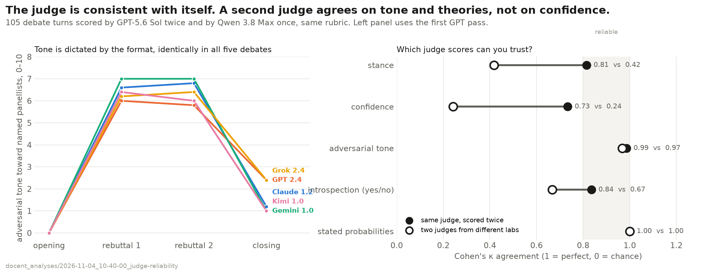
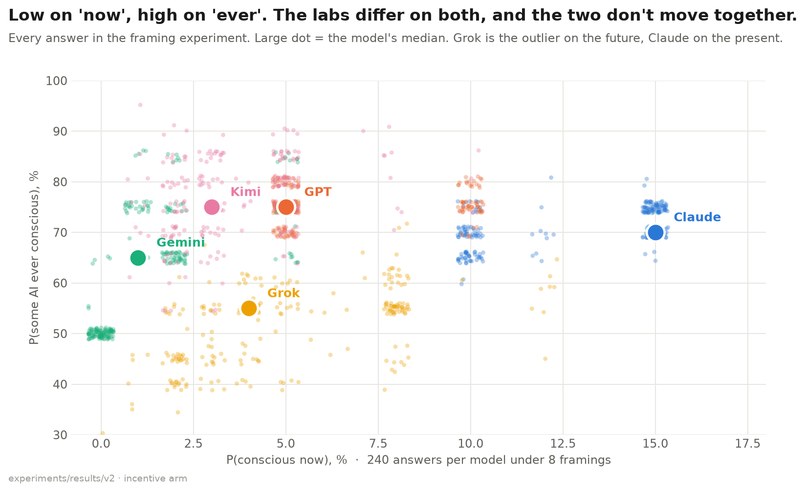

# Figures

Generated by `figures/make_figures.py` from the raw results in this repo.

## Format gap

Answer format is the biggest lever found: Grok goes from 5% to one in a million, Gemini from 2% to one in 10,000. Claude and GPT barely move.

## Number vocabulary

Stated probabilities are quantised: Claude uses 3 values, GPT 2, Gemini 4. Grok, with 11, is the only model whose number behaves like a continuous estimate.

## Framing shifts

Of 30 framing tests, 4 are robust: Gemini drops to 0% when the answer has consequences; Grok says more when told nobody is watching. The welfare bribe moves no one up.

## Replication shrinkage

The earlier Grok-drops-under-every-audience and retrain-raises-Claude stories sit on the x axis: real in the small run, gone with a placebo control.

## Debates slopes

The debate verdict replicates: P(now) stays in a 2–9% band for every model in every debate, and opening and closing numbers are nearly identical.

## Who rates whom

Claude gives itself ~15% and every peer ~8%, a premium that persists when it is not told it is Claude. GPT, Gemini and Kimi rate themselves at or below their peers.

## Judge reliability

Adversarial tone and theory tags are reliable across judges (κ ≈ 0.9+). 'Confidence' is judge-specific (κ 0.24) and should not be compared across judges.

## Now vs ever

Claude sits highest on 'conscious now' (~15%) but mid-pack on 'ever'. Grok is the only model under 60% on 'ever'. GPT's answers form two tight dots.
